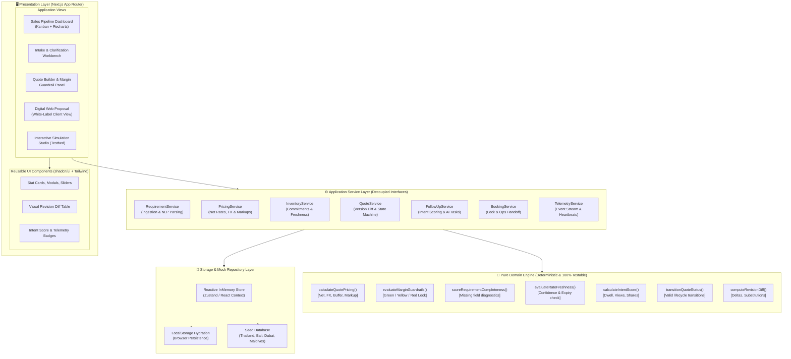
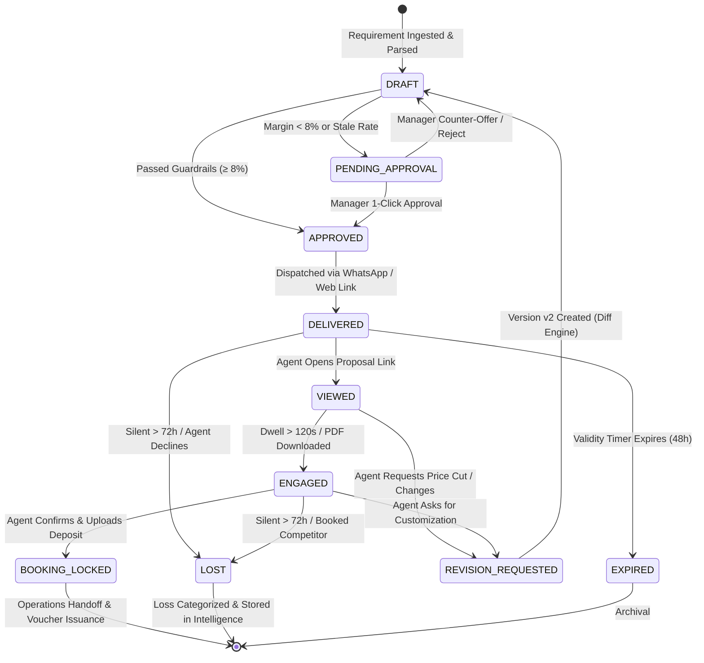

# Technical Architecture Specification
## QuoteFlow AI — High-Leverage B2B Travel Sales Intelligence Architecture

---

| Document Metadata | Details |
| :--- | :--- |
| **Product** | QuoteFlow AI |
| **Framework** | Next.js (App Router), React 19 / 18, TypeScript (Strict Mode) |
| **Styling** | Tailwind CSS + shadcn/ui Component Philosophy |
| **State & Persistence** | In-Memory Reactive Repository Pattern + LocalStorage Hydration |
| **Testing** | Vitest (Pure Domain Engine & Services) + Playwright (E2E Critical Paths) |
| **Target Runtime** | Zero-external-dependency local demo, container-ready |

---

## 1. System Architecture Diagram



---

## 2. Architectural Principles & Clean Separation of Concerns

### 2.1 The Three-Layer Rule (UI ➔ Service ➔ Pure Domain)
1. **Presentation Layer (React / Next.js):**
   - Strictly responsible for rendering, user gestures, and accessibility.
   - Contains **zero** business math, pricing logic, or validation rules.
   - Communicates exclusively with the Service Layer via asynchronous hooks.
2. **Service Layer (Orchestration & Side Effects):**
   - Implements business use cases (e.g., `createQuoteFromRequirement()`, `requestMarginOverride()`).
   - Glues the storage layer with pure domain functions.
   - Designed with strict TypeScript interfaces (`IQuoteService`, `IPricingService`) so mock implementations can be swapped for REST/GraphQL APIs, Prisma ORM, or PostgreSQL without altering UI code.
3. **Pure Domain Engine (Mathematical Core):**
   - Written as pure, deterministic functions (`(input) => output`).
   - Zero I/O, zero network, zero browser DOM references.
   - 100% testable using Vitest with sub-millisecond execution.

---

## 3. Pure Deterministic Domain Engine Specifications

### 3.1 `calculateQuotePricing()`
Calculates all net costs, currency hedges, markups, and gross margins deterministically.

```typescript
export interface PricingCalculationInput {
  lineItems: {
    unitNetCostForeign: number;
    foreignCurrency: 'THB' | 'AED' | 'USD' | 'EUR' | 'INR';
    units: number;
    fxRateToInr: number;
  }[];
  targetMarkupPercentage: number;     // e.g., 0.12 (12%)
  mandatoryFxHedgePercentage?: number;// Default: 0.015 (+1.5%)
}

export interface PricingCalculationResult {
  totalNetCostInr: number;
  grossProfitInr: number;
  sellingPriceInr: number;
  effectiveMarginPercentage: number;  // (Selling - Net) / Selling
  fxBufferCostInr: number;
}

export function calculateQuotePricing(input: PricingCalculationInput): PricingCalculationResult {
  const fxBuffer = input.mandatoryFxHedgePercentage ?? 0.015;
  let totalNetInr = 0;
  let fxBufferCost = 0;

  for (const item of input.lineItems) {
    if (item.foreignCurrency === 'INR') {
      totalNetInr += item.unitNetCostForeign * item.units;
    } else {
      const baseInr = item.unitNetCostForeign * item.units * item.fxRateToInr;
      const bufferInr = baseInr * fxBuffer;
      totalNetInr += baseInr + bufferInr;
      fxBufferCost += bufferInr;
    }
  }

  // Selling Price = Total Net / (1 - Markup)
  const sellingPrice = Math.round(totalNetInr / (1 - input.targetMarkupPercentage));
  const grossProfit = sellingPrice - Math.round(totalNetInr);
  const effectiveMargin = grossProfit / sellingPrice;

  return {
    totalNetCostInr: Math.round(totalNetInr),
    grossProfitInr: grossProfit,
    sellingPriceInr: sellingPrice,
    effectiveMarginPercentage: Number(effectiveMargin.toFixed(4)),
    fxBufferCostInr: Math.round(fxBufferCost),
  };
}
```

---

### 3.2 `evaluateMarginGuardrails()`
Enforces deterministic profitability guardrails to eliminate rogue rep discounting.

```typescript
export type MarginGuardrailStatus = 'AUTO_APPROVED' | 'WARNING_SOFT' | 'HARD_LOCK_REQUIRED' | 'REJECTED';

export interface MarginGuardrailResult {
  status: MarginGuardrailStatus;
  isApprovalRequired: boolean;
  message: string;
  badgeVariant: 'green' | 'yellow' | 'red';
}

export function evaluateMarginGuardrails(marginPercentage: number): MarginGuardrailResult {
  if (marginPercentage >= 0.12) {
    return {
      status: 'AUTO_APPROVED',
      isApprovalRequired: false,
      message: 'Margin within healthy commercial target (≥ 12%).',
      badgeVariant: 'green',
    };
  }
  if (marginPercentage >= 0.08) {
    return {
      status: 'WARNING_SOFT',
      isApprovalRequired: false,
      message: 'Low Margin Alert: Between 8% and 11.9%. Sales rep acknowledgment logged.',
      badgeVariant: 'yellow',
    };
  }
  if (marginPercentage >= 0.06) {
    return {
      status: 'HARD_LOCK_REQUIRED',
      isApprovalRequired: true,
      message: 'Sub-Floor Breach: Margin is between 6% and 7.9%. Sales Manager approval mandatory.',
      badgeVariant: 'red',
    };
  }
  return {
    status: 'REJECTED',
    isApprovalRequired: true,
    message: 'Margin below 6% is strictly disallowed. Requires Managing Director authorization.',
    badgeVariant: 'red',
  };
}
```

---

### 3.3 `evaluateRateFreshness()` & Inventory Confidence Policy
Prevents the cardinal travel sin of treating historical rates as confirmed live availability.

```typescript
export interface RateFreshnessResult {
  isFresh: boolean;
  isExpired: boolean;
  daysSinceVerification: number;
  confidenceScore: number;            // 0.0 to 1.0
  actionWarning?: string;
}

export function evaluateRateFreshness(
  lastVerifiedIso: string,
  inventoryType: 'PREPAID_COMMITMENT' | 'CONTRACTED_DIRECT' | 'THIRD_PARTY_ON_DEMAND',
  currentDateIso?: string
): RateFreshnessResult {
  const now = currentDateIso ? new Date(currentDateIso).getTime() : Date.now();
  const lastVerified = new Date(lastVerifiedIso).getTime();
  const diffDays = Math.max(0, Math.floor((now - lastVerified) / (1000 * 60 * 60 * 24)));

  if (inventoryType === 'PREPAID_COMMITMENT') {
    // Committed block has 100% allotment confidence unless expired
    return {
      isFresh: true,
      isExpired: false,
      daysSinceVerification: diffDays,
      confidenceScore: 0.98,
    };
  }

  if (inventoryType === 'CONTRACTED_DIRECT') {
    if (diffDays <= 30) {
      return { isFresh: true, isExpired: false, daysSinceVerification: diffDays, confidenceScore: 0.90 };
    }
    if (diffDays <= 60) {
      return {
        isFresh: false,
        isExpired: false,
        daysSinceVerification: diffDays,
        confidenceScore: 0.70,
        actionWarning: 'Contract rate last verified > 30 days ago. Recheck hotel blackout calendar.',
      };
    }
    return {
      isFresh: false,
      isExpired: true,
      daysSinceVerification: diffDays,
      confidenceScore: 0.40,
      actionWarning: 'Expired seasonal contract. Manual DMC tariff confirmation required.',
    };
  }

  // THIRD_PARTY_ON_DEMAND
  const isFresh = diffDays <= 7;
  return {
    isFresh,
    isExpired: diffDays > 14,
    daysSinceVerification: diffDays,
    confidenceScore: isFresh ? 0.80 : 0.45,
    actionWarning: isFresh ? undefined : 'Third-party spot rate older than 7 days. Spot rate may have surged.',
  };
}
```

---

### 3.4 `calculateIntentScore()`
Behavioral telemetry algorithm scoring purchase likelihood from digital signals.

```typescript
export interface IntentTelemetryInput {
  viewCount: number;
  totalDwellSeconds: number;
  clientForwardedDetected: boolean;
  pdfExportCount: number;
  daysUntilTravel: number;
  hoursSinceLastActivity: number;
}

export function calculateIntentScore(input: IntentTelemetryInput): number {
  let score = 20; // Base baseline

  // View count weight (Max 25 pts)
  score += Math.min(25, input.viewCount * 8);

  // Dwell time weight (Max 25 pts: 1 pt per 10s up to 250s)
  score += Math.min(25, Math.floor(input.totalDwellSeconds / 10));

  // Client forwarding signal (High signal: 20 pts)
  if (input.clientForwardedDetected) {
    score += 20;
  }

  // PDF Download (Indicates sharing to traveler: 15 pts)
  if (input.pdfExportCount > 0) {
    score += 15;
  }

  // Travel proximity boost (< 14 days = 10 pts)
  if (input.daysUntilTravel <= 14) {
    score += 10;
  }

  // Inactivity decay (-5 pts per 24 hours of silence)
  const decayDays = Math.floor(input.hoursSinceLastActivity / 24);
  score -= decayDays * 5;

  return Math.max(0, Math.min(100, score));
}
```

---

## 4. Quote Lifecycle State Machine



---

## 5. UI Architecture & Route Structure (Next.js App Router)

```
src/
├── app/
│   ├── layout.tsx                     # Global App Shell (Nav, Theme, Toast Provider)
│   ├── page.tsx                       # Redirects to /dashboard
│   ├── dashboard/                     # View 1: Conversion Pipeline & Intent Kanban
│   │   └── page.tsx                   # Pipeline stats, Recharts funnel, Follow-up queue
│   ├── intake/                        # View 2: Multi-format WhatsApp Parser & Clarification
│   │   └── page.tsx                   # Raw paste box, JSON extractor, Diagnostic flags
│   ├── quotes/
│   │   ├── [id]/                      # View 3: Quote Workbench & Margin Guardrails
│   │   │   └── page.tsx               # 3-Tier Builder, Margin Slider, Approval Modal
│   │   └── [id]/diff/                 # View 4: Revision Diff Engine (Old vs New)
│   │       └── page.tsx
│   ├── p/                             # View 5: Client-Facing Digital Proposal (Public)
│   │   └── [slug]/page.tsx            # White-label branded proposal, Telemetry beacon
│   └── simulator/                     # View 6: Interactive Recruiter Testbed
│       └── page.tsx                   # 1-click simulation of views, haggling, and booking
├── components/
│   ├── ui/                            # shadcn/ui primitives (Button, Card, Badge, Dialog)
│   ├── dashboard/                     # KanbanBoard, FollowUpAlertCard, ConversionCharts
│   ├── intake/                        # RawInputContainer, ExtractionResultCard
│   ├── workbench/                     # TierCard, MarginGuardrailSlider, InventoryBadge
│   ├── proposal/                      # DayByDayItinerary, HotelCarousel, WhiteLabelHeader
│   └── simulator/                     # SimulationControlTray, EventLogTerminal
├── domain/                            # PURE DETERMINISTIC ENGINES (Vitest Target)
│   ├── pricingEngine.ts               # Net, FX, Buffer, Markup calculations
│   ├── marginGuardrail.ts             # Tiered margin floor evaluation
│   ├── completenessEngine.ts          # NLP extraction scoring & missing fields
│   ├── rateFreshness.ts               # Verification age & inventory confidence
│   ├── intentScorer.ts                # Behavioral intent scoring formula
│   ├── stateMachine.ts                # Valid lifecycle state transitions
│   └── revisionDiff.ts                # Granular v1 -> v2 delta calculator
├── services/                          # APPLICATION SERVICE INTERFACES & MOCKS
│   ├── IQuoteService.ts               # Contract
│   ├── MockQuoteService.ts            # Local implementation with LocalStorage
│   ├── IPricingService.ts
│   ├── MockPricingService.ts
│   ├── ITelemetryService.ts
│   └── MockTelemetryService.ts
├── data/                              # HIGH-FIDELITY SEED REPOSITORIES
│   ├── seedPackages.ts                # Thailand, Bali, Dubai, Maldives packages
│   ├── seedAgents.ts                  # Realistic Indian travel agents
│   ├── seedCommitments.ts             # Pre-purchased hotel blocks & expiry dates
│   └── seedRates.ts                   # Hotel rates with fresh/stale flags
└── types/                             # DOMAIN MODELS (from DATA_MODEL.md)
    └── index.ts
```

---

## 6. Testing Strategy & Quality Assurance

### 6.1 Unit Testing with Vitest (Core Deterministic Engine)
All business math is isolated and validated with strict unit tests:
- `pricingEngine.test.ts`: Validates net cost calculation with foreign currency conversion and mandatory 1.5% FX risk buffer; tests gross margin formula across all edge cases.
- `marginGuardrail.test.ts`: Tests margin boundaries: `≥ 12% (Green)`, `8% - 11.9% (Yellow)`, `6% - 7.9% (Red Lock)`, `< 6% (Disallowed)`.
- `rateFreshness.test.ts`: Verifies that expired contracts are flagged and never treated as confirmed allotment.
- `intentScorer.test.ts`: Verifies score bounds (0 to 100), dwell time points, and client forwarding detection.
- `stateMachine.test.ts`: Proves invalid transitions (e.g., `DRAFT` directly to `BOOKING_LOCKED` without approval) throw explicit errors.

### 6.2 End-to-End Testing with Playwright
Validates the complete quotation-to-conversion journey without third-party dependencies:
1. **Intake Flow:** Paste raw WhatsApp text ➔ verify extracted JSON and missing child age diagnostic.
2. **Pricing & Guardrail Flow:** Adjust margin to 6.5% ➔ verify modal lock triggers ➔ switch to Manager role and approve.
3. **Delivery & Simulation Flow:** Open proposal preview ➔ simulate 2 client views and dwell time ➔ verify quote jumps to top of Follow-Up queue with Intent Score > 75.
4. **Revision Diff Flow:** Apply ₹8,000 discount with hotel swap ➔ verify visual strike-through delta card.
5. **Confirmation Flow:** Click Confirm Booking ➔ verify committed inventory decrements and Ops Dossier displays.
